<div align="center">



# ☁️ Awesome Cloud Management

[](https://github.com/ishandutta2007/Awesome-Awesome-Awesome) <a href="https://discord.gg/jc4xtF58Ve"></a> [](https://github.com/ishandutta2007/Awesome-Cloud-Management/stargazers) [](https://github.com/ishandutta2007/Awesome-Cloud-Management/network/members) [](LICENSE) [](https://github.com/ishandutta2007/Awesome-Cloud-Management/pulls) <a href="https://github.com/ishandutta2007"></a>

**A definitive, curated index of Cloud Management Platforms (CMP), Multi-Cloud Orchestration Engines, FinOps Cloud Spend Governance Tools, and Open-Source Sovereign Infrastructure Frameworks.**

*Empowering platform engineers, enterprise cloud architects, FinOps practitioners, and DevOps teams to orchestrate, optimize, and govern public, private, and hybrid cloud estates.*

---

</div>

## 📑 Table of Contents

- [🌐 Sector Overview & Market Dynamics](#-sector-overview--market-dynamics)
- [🏢 SaaS & Enterprise Hosted Platforms](#-saas--enterprise-hosted-platforms)
- [🚀 Open-Source Cloud Management Projects](#-open-source-cloud-management-projects)
- [🧩 Architecture & Stack Recommendations](#-architecture--stack-recommendations)
- [📈 Star History](#-star-history)
- [🤝 How to Contribute](#-how-to-contribute)
- [☕ Support & Community](#-support--community)
- [📄 Disclaimer & License](#-disclaimer--license)

---

## 🌐 Sector Overview & Market Dynamics

The global **Cloud Management Platform (CMP)** and **Multi-Cloud Management** market is currently estimated between **$13.4 Billion and $17.1 Billion in 2025–2026**, on track to expand at a rapid **CAGR of ~22.4%** to exceed **$85 Billion by 2034**. Enterprise multi-cloud diversification (simultaneously managing AWS, Microsoft Azure, Google Cloud, and on-premises hypervisors), surging AI/ML workload costs, and stringent regulatory compliance have turned centralized cloud governance and FinOps into non-negotiable operational priorities.

The sector demonstrates **moderate fragmentation**: while established enterprise software conglomerates (Broadcom, IBM, ServiceNow, HPE) control significant shares of traditional IT Operations Management (ITOM) budgets, no single vendor maintains a winner-take-all lock. Continuous innovation across containerized environments, developer-first shift-left FinOps tooling, and high enterprise demand for open-source, sovereign Infrastructure-as-Code (IaC) governance ensure a fiercely competitive landscape where specialized platforms thrive alongside major enterprise suites.

---

## 🏢 SaaS & Enterprise Hosted Platforms

The following table indexes prominent commercial Cloud Management Platforms, sorted in descending order by parent company scale (valuation / market capitalization).

| Company Size (Valuation / Revenue) | Platform & Vendor | Primary Focus & Capabilities | Starting Tier Pricing | Free Tier / Free Trial Limits |
| :--- | :--- | :--- | :--- | :--- |
| **~$780B Valuation**<br>*(Broadcom: $51.6B Rev)* | **[CloudHealth by Broadcom](https://www.broadcom.com/)** | Enterprise multi-cloud FinOps spend visibility, AI Intelligent Assist co-pilot, automated budget tracking, and custom policy guardrails across AWS, Azure, and GCP. | **$45,000/year**<br>*(CH150K tier covers up to $150K/month managed AWS spend; overage ~$0.03/dollar)* | **14-day free trial** on AWS Marketplace (full feature access for up to 1 connected cloud account / $150K monthly spend ceiling). |
| **~$215B Valuation**<br>*(IBM: $62.1B Rev)* | **[Turbonomic (IBM)](https://www.ibm.com/products/turbonomic)** | AI-driven Application Resource Management (ARM) continuously optimizing VM, container, and database allocation across hybrid and multi-cloud infrastructure. | **~$40,000/year**<br>*(Foundational tier covers entry 200-workload block; scales at ~$180–$250 per virtual server annually)* | **30-day free trial** with full optimization features and unlimited workload visibility across AWS, Azure, and GCP (no credit card required). |
| **~$215B Valuation**<br>*(IBM: $62.1B Rev)* | **[Apptio Cloudability (IBM)](https://www.apptio.com/products/cloudability/)** | Deep enterprise FinOps financial management, unit economics modeling, commitment lifecycle automation (RIs/Savings Plans), and multi-cloud anomaly detection. | **$2,500/month**<br>*($30,000/year billed annually for environments managing up to $1M in annual public cloud spend)* | **14-day free trial** via sales/marketplace evaluation with complete multi-cloud cost visibility (no permanent free tier). |
| **~$190B Valuation**<br>*(ServiceNow: $10.5B Rev)* | **[ServiceNow Cloud Provisioning and Governance](https://www.servicenow.com/)** | Unified ITOM Cloud Management module enabling self-service service catalogs, Terraform cloud provisioning, automated policy compliance, and enterprise CMDB sync. | **~$8,000–$15,000/year**<br>*(Base discovery & ITOM provisioning starts at ~$0.50–$1.50 per monitored node/month)* | **15-day sales-assisted PoC trial**; permanent free Personal Developer Instance (PDI) for core Now platform features (CPG plugin restricted). |
| **~$28B Valuation**<br>*(HPE: $29.1B Rev)* | **[Morpheus Data (HPE)](https://morpheusdata.com/)** | Infrastructure-agnostic multi-cloud automation and orchestration platform spanning bare metal, hypervisors (VMware, Nutanix, KVM), containers, and public clouds. | **~$10,000/year**<br>*(Entry concurrent workload element packs start at ~$100–$150 per managed workload element annually)* | **Free Community Edition** (free forever up to 3 physical sockets / non-commercial homelab use); **60-day free trial** for Morpheus VM Essentials. |
| **~$26B Valuation**<br>*(NetApp: $6.3B Rev)* | **[Spot by NetApp](https://www.netapp.com/)** | Continuous compute automation that optimizes infrastructure SLA, utilizing spot instances (Elastigroup) and dynamic Kubernetes container rightsizing (Ocean). | **~$0.15/vCPU-hour**<br>*(Usage-based public rate or ~20% of net realized compute savings generated)* | **Free forever plan** supporting up to **20 virtual machines (VMs)**; **14-day free trial** with full automated scaling and zero workload restrictions. |
| **~$17B Valuation**<br>*(Nutanix: $2.1B Rev)* | **[Nutanix NCM Cost Governance](https://www.nutanix.com/products/cloud-manager)** | Multi-cloud and hybrid infrastructure cost control (formerly Nutanix Beam) providing showback/chargeback, automated rightsizing, and cloud security compliance. | **$99/month**<br>*(Standard Tier for 1 cloud account; Professional multi-account tier starts at $299/month)* | **90-day free trial** with full multi-cloud cost visibility, budget tracking, and optimization recommendations across AWS, Azure, GCP, and Nutanix. |
| **~$3.0B Valuation**<br>*(Private Equity: TA / Thoma Bravo)* | **[Flexera One](https://www.flexera.com/)** | Hybrid IT asset management and multi-cloud governance platform incorporating Snow Commander for automated provisioning, lifecycle decommissioning, and FinOps. | **~$5,000–$13,000/year**<br>*(Entry SaaS modules; Cloud Cost Optimization tier starts at ~$50,000/year managing up to $1M cloud spend)* | **14-day assisted proof-of-concept (PoC) trial** upon demo qualification with sales team (no permanent free tier). |
| **~$200M Valuation**<br>*(Insight Partners backed)* | **[CloudBolt](https://www.cloudbolt.io/)** | Hybrid cloud management platform providing blueprint-based self-service orchestration, day-2 operations automation, and MCP-based AI agent governance. | **~$8,500/year**<br>*(Annual commercial starter license, or ~£6 per managed VM/month via framework schedules)* | **Free forever edition** of the full CMP platform for up to **100 managed resources** (virtual machines, clusters, databases, and networks). |
| **~$80M Valuation**<br>*(Series A/B funded)* | **[Scalr](https://scalr.io/)** | Terraform and OpenTofu remote operations collaboration backend, offering full GitOps workflows, automated drift detection, OPA policy enforcement, and AI MCP integration. | **$0.99 per run**<br>*(Business Plan pay-as-you-go or $99/month for 100 prepaid execution runs)* | **Free forever plan** supporting up to **50 runs per month** with 5 concurrent execution runners and full OPA policy enforcement. |

---

## 🚀 Open-Source Cloud Management Projects

Open-source and self-hosted tools provide total sovereignty, eliminate per-workload software licensing, and integrate natively into GitOps CI/CD pipelines. 

The list below is sorted in descending order by GitHub stargazers count:

- **[LocalStack](https://github.com/localstack/localstack)** [](https://github.com/localstack/localstack/stargazers)  
  *A fully functional local AWS cloud stack.* Develop, emulate, and test multi-cloud serverless, container, and IaaS components offline without generating cloud vendor bills or security risks.

- **[OpenTofu](https://github.com/opentofu/opentofu)** [](https://github.com/opentofu/opentofu/stargazers)  
  *Declarative multi-cloud infrastructure orchestration engine.* Community-driven, open-source Linux Foundation alternative to Terraform that reliably provisions and manages resources across AWS, Azure, GCP, and thousands of infrastructure providers.

- **[Infracost](https://github.com/infracost/infracost)** [](https://github.com/infracost/infracost/stargazers)  
  *Cloud cost intelligence for platform engineers and CI/CD pipelines.* Shifts FinOps left by estimating the exact financial cost differences of pull requests and infrastructure-as-code changes before merging.

- **[Spinnaker](https://github.com/spinnaker/spinnaker)** [](https://github.com/spinnaker/spinnaker/stargazers)  
  *Open-source, multi-cloud continuous delivery and cloud resource deployment platform.* Engineered originally by Netflix and Google for fast, reproducible, and automated multi-region deployments across AWS EC2, Kubernetes, and Google Cloud.

- **[Atlantis](https://github.com/runatlantis/atlantis)** [](https://github.com/runatlantis/atlantis/stargazers)  
  *Terraform and OpenTofu pull request automation.* Facilitates GitOps collaboration across engineering teams by executing plans and applies directly through pull request comments with strict state locks.

- **[Steampipe](https://github.com/turbot/steampipe)** [](https://github.com/turbot/steampipe/stargazers)  
  *The extensible zero-ETL SQL engine for cloud operations.* Query live cloud infrastructure, evaluate security postures, audit compliance frameworks, and analyze spending across AWS, Azure, GCP, and Kubernetes using standard SQL.

- **[OpenCost](https://github.com/opencost/opencost)** [](https://github.com/opencost/opencost/stargazers)  
  *CNCF vendor-neutral open-source Kubernetes cost monitoring framework.* Delivers granular real-time visibility into microservice, namespace, deployment, and container spending across multi-cloud clusters.

- **[Cloud Custodian](https://github.com/cloud-custodian/cloud-custodian)** [](https://github.com/cloud-custodian/cloud-custodian/stargazers)  
  *CNCF incubating rules engine for cloud security, FinOps cost optimization, and governance.* Employs human-readable YAML policies to filter, audit, tag, and remediate cloud resources in real time across AWS, Azure, and GCP.

- **[Digger](https://github.com/diggerhq/digger)** [](https://github.com/diggerhq/digger/stargazers)  
  *Open-source IaC orchestration platform.* Runs Terraform and OpenTofu directly inside your existing CI/CD runners (GitHub Actions, GitLab CI) with concurrency control, PR-level cost estimates, and OPA policy guardrails.

- **[Komiser](https://github.com/mlabouardy/komiser)** [](https://github.com/mlabouardy/komiser/stargazers)  
  *Open-source cloud environment inspector and inventory visualizer.* Discovers unused cloud resources, misconfigurations, and budget leaks across AWS, GCP, Azure, DigitalOcean, and Kubernetes environments.

- **[Apache CloudStack](https://github.com/apache/cloudstack)** [](https://github.com/apache/cloudstack/stargazers)  
  *Mature open-source Infrastructure-as-a-Service (IaaS) cloud management platform.* Orchestrates compute, network, and storage resources to build massive public, private, and hybrid enterprise clouds.

- **[OptScale](https://github.com/hystax/optscale)** [](https://github.com/hystax/optscale/stargazers)  
  *Self-hosted open-source FinOps and cloud cost management engine (Apache 2.0).* Specializes in tracking and optimizing high-performance GPU, AI/ML, and containerized workloads across AWS, Azure, GCP, and Alibaba Cloud.

- **[OpenNebula](https://github.com/OpenNebula/one)** [](https://github.com/OpenNebula/one/stargazers)  
  *Simple, powerful open-source Cloud & Edge Computing Platform.* Unifies VM lifecycle management, edge compute deployments, and sovereign multi-tenant enterprise cloud operations.

- **[ManageIQ](https://github.com/ManageIQ/manageiq)** [](https://github.com/ManageIQ/manageiq/stargazers)  
  *Robust open-source hybrid cloud management platform (upstream of Red Hat CloudForms).* Manages containers, virtual machines, and cloud workloads with policy-based governance, automated lifecycle discovery, and chargeback reporting.

- **[kube-green](https://github.com/kube-green/kube-green)** [](https://github.com/kube-green/kube-green/stargazers)  
  *Kubernetes operator for automated cluster carbon reduction.* Suspends idle non-production pods, deployments, and cron jobs outside business operating hours, slashing unnecessary cloud computing invoices.

- **[Terrakube](https://github.com/terrakube-io/terrakube)** [](https://github.com/terrakube-io/terrakube/stargazers)  
  *Self-hosted open-source IaC collaboration platform (Apache 2.0).* Serves as a full replacement for Terraform Enterprise, offering private module and provider registries, workspace state management, and VCS integration on Kubernetes.

- **[Terracost](https://github.com/cycloidio/terracost)** [](https://github.com/cycloidio/terracost/stargazers)  
  *European sovereign cloud cost estimation engine for Terraform CLI plans.* Computes exact cost differentials before provisioning infrastructure to avoid financial surprises.

- **[BoaviztAPI](https://github.com/Boavizta/boaviztapi)** [](https://github.com/Boavizta/boaviztapi/stargazers)  
  *Open-source API and environmental methodology suite.* Evaluates the ecological impact, power usage, and carbon emissions of server instances and multi-cloud hardware.

- **[Fulcrum Core](https://github.com/fulcrumproject/core)** [](https://github.com/fulcrumproject/core/stargazers)  
  *European open-source sovereign cloud infrastructure orchestrator supported by CISPE.cloud.* Coordinates distributed cloud providers, agents, and provisioned services through a unified Go-based control plane.

---

## 🧩 Architecture & Stack Recommendations

To build a **100% sovereign, self-hosted, vendor-neutral Cloud Management Stack**, combine the following open-source components:

```
┌────────────────────────────────────────────────────────┐
│                   GITOPS & DEVELOPER UI                │
│       Terrakube (IaC Workspaces) + Atlantis / Digger    │
└──────────────────────────┬─────────────────────────────┘
                           │
┌──────────────────────────▼─────────────────────────────┐
│                 POLICY & SHIFT-LEFT FINOPS             │
│    Cloud Custodian (Governance) + Infracost (PR Diffs)  │
└──────────────────────────┬─────────────────────────────┘
                           │
┌──────────────────────────▼─────────────────────────────┐
│              MULTI-CLOUD INFRASTRUCTURE ENGINE         │
│          OpenTofu (Multi-Cloud Declarative IaC)         │
│       Apache CloudStack / OpenNebula (Hybrid / Bare)   │
└──────────────────────────┬─────────────────────────────┘
                           │
┌──────────────────────────▼─────────────────────────────┐
│            CONTINUOUS RUNTIME COST & AUDITING          │
│    OptScale (Multi-Cloud / GPU) + OpenCost (Kubernetes) │
│    Steampipe (SQL Posture) + kube-green (Idle Off)     │
└────────────────────────────────────────────────────────┘
```

---

## 📈 Star History

[](https://star-history.dera.page/#ishandutta2007/Awesome-Cloud-Management&type=date&legend=top-left)

---

## 🤝 How to Contribute

Contributions are warmly welcomed! Help keep this ecosystem guide complete, accurate, and up-to-date:

1. **Fork the repository** to your GitHub account.
2. **Create a descriptive feature branch** (`git checkout -b feature/add-new-cmp-tool`).
3. **Add or edit entries** adhering strictly to the existing tabular and list formats:
   - Provide verified starting tier prices (avoid generic "Contact Sales" or "Custom" where public numbers exist).
   - Document specific free tier limits or free trial durations.
   - For open-source projects, include the social badge linking to stargazers.
4. **Commit your modifications** with clear commit messages.
5. **Submit a Pull Request** summarizing the additions or corrections with official documentation links.

---

## ☕ Support & Community

If this curated repository helps you navigate cloud complexity, optimize multi-cloud infrastructure bills, or design modern platform engineering stacks:

- ⭐ **Star this repository** to improve visibility and help other cloud architects discover it.
- 🍴 **Fork and share** it with your engineering colleagues and FinOps community.
- 💬 **Join our discussions** on our [Discord Community](https://discord.gg/jc4xtF58Ve) to connect with fellow DevOps engineers and builders.
- ☕ **Support continuous maintenance**: Buy us a coffee and back our open-source research on the [GitHub Sponsor Dashboard](https://github.com/sponsors/ishandutta2007).

Your sponsorship and community engagement keep this directory continuously updated, vendor-neutral, and free for everyone. Thank you! 🙌

---

## 📄 Disclaimer & License

- **Disclaimer:** All product names, logos, and brands are property of their respective owners. Listing in this repository is strictly informational and does not constitute an official endorsement. Cloud management platforms require elevated cloud permissions; ensure appropriate least-privilege RBAC and audit procedures are enforced.
- **License:** Distributed under the permissive [MIT License](LICENSE). Curated with ❤️ by [Ishan Dutta](https://github.com/ishandutta2007) and the open-source community.
